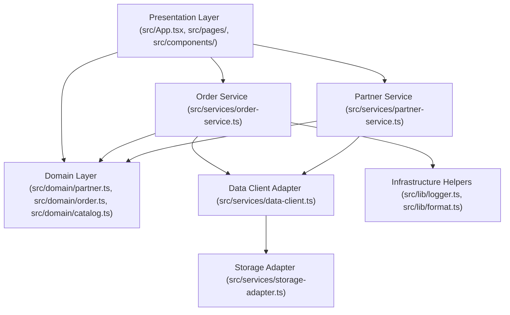

# Architecture — Skalee Delivery

## Overview

`Skalee Delivery` is a client-side Single Page Application (SPA) built with **React 19**, **Vite**, and **TypeScript (strict mode)**. It functions as a multi-segment marketplace platform (drinks & convenience, burgers, pizzas, bowls) while separating domain rules and data access from presentation components so that UI screens remain fast, testable, and independent of remote persistence providers.

## Directory Structure

```text
d:\Delivery-Skalee/
├── .agents/
│   ├── rules/                # Google Antigravity orchestration & process rules
│   └── skills/               # On-demand workspace skills (React, composition, UI, writing)
├── docs/
│   ├── prompts/              # Reusable security-review prompt
│   ├── architecture.md       # Structure, boundaries, and technical decisions
│   ├── design.md             # Visual direction, mobile-first layout, and accessibility
│   ├── onboarding.md         # Local preparation and first workflow
│   ├── quality.md            # Quality gates, ESLint tiers, and verification pipeline
│   ├── setup.md              # Toolkit revision, coverage matrix, and setup evidence
│   └── task-handoff.template.md
├── eslint-rules/             # Local ESLint plugin ("quality/*") and RuleTester self-check
├── src/
│   ├── components/           # Reusable presentation components
│   │   ├── BottomNavBar.tsx           # Fixed bottom navigation bar (Início, Busca, Pedidos, Perfil)
│   │   ├── CartConflictModal.tsx      # Modal enforcing single-partner order constraint
│   │   ├── CategoryGrid.tsx           # 10-category grid with 3D-styled illustrated badges
│   │   ├── CatalogPanel.tsx           # Digital menu with search and category filters
│   │   ├── CheckoutDeliveryForm.tsx   # Accessible delivery address and checkout form
│   │   ├── CustomerCartPanel.tsx      # Customer cart with items, totals, and checkout
│   │   ├── CustomerOrdersView.tsx     # Orders tab with live tracking and history
│   │   ├── CustomerOrderTracker.tsx   # Real-time customer order tracking stepper
│   │   ├── CustomerProfileView.tsx    # Customer profile and protected admin access
│   │   ├── CustomerTabRouter.tsx      # Tab router isolating view switching
│   │   ├── FloatingCartButton.tsx     # Mobile floating cart action button
│   │   ├── HomeHeader.tsx             # White top header with greeting, address, and bell
│   │   ├── HomeView.tsx               # Mobile-first Home orchestrating the 6-tier hierarchy
│   │   ├── OrderCard.tsx              # Order board card with status advancement
│   │   ├── PartnerCard.tsx            # Partner storefront preview card
│   │   ├── PartnerHeader.tsx          # Partner details header and navigation
│   │   ├── PartnerStorefrontView.tsx  # Partner-specific catalog and cart layout
│   │   ├── PromoCarousel.tsx          # Demonstrative promotional carousel with dots
│   │   ├── RecentStoresSection.tsx    # Recent stores based on local history
│   │   └── SearchView.tsx             # Dedicated search tab with quick suggestion chips
│   ├── domain/               # Pure domain types, status state machines, and centavo calculations
│   │   ├── catalog.ts               # Product catalog, cart items, and delivery fee rules
│   │   ├── order.ts                 # Order lifecycle, totals, and validation rules
│   │   └── partner.ts               # Partner model, segments, and future user roles/profiles
│   ├── lib/                  # Shared utilities (format.ts, logger.ts)
│   ├── pages/                # Screen views
│   │   ├── AdminOrderBoard.tsx      # Admin operational order queue board (with partner filter)
│   │   └── CustomerStorefront.tsx   # Marketplace directory & partner storefront orchestrator
│   ├── services/             # Data access adapters and domain coordinators
│   │   ├── data-client.ts           # In-memory stores with localStorage persistence
│   │   ├── order-service.ts         # Orders, catalog listing, and cart persistence coordinator
│   │   ├── partner-service.ts       # Partner search, filtering, and retrieval coordinator
│   │   └── storage-adapter.ts       # Safe localStorage wrapper with memory fallback for tests/SSR
│   ├── App.tsx               # Root operational shell with customer/admin view switcher
│   ├── main.tsx              # Vite application entry point
│   ├── styles.css            # Responsive mobile-first styles, status tokens, and a11y focus
│   └── vite-env.d.ts         # Vite client type declarations
├── eslint.config.mjs         # Fast ESLint configuration (syntactic + local quality rules)
├── eslint.typed.config.mjs   # Focused type-aware ESLint configuration (async safety)
├── tsconfig.json             # Solution TypeScript references
├── tsconfig.app.json         # Application TypeScript configuration (strict, @/* path alias)
├── tsconfig.node.json        # Node/Vite tooling TypeScript configuration
└── vite.config.ts            # Vite bundler and Vitest test runner configuration
```

## Layer Boundaries and Invariants



1. **Presentation (`src/App.tsx`, `src/pages/**`, `src/components/**`, `*.tsx`)**:
   - Renders accessible HTML, handles user interactions, and delegates state mutations to `src/services/`.
   - **Enforced Boundary**: Blocked by `quality/no-direct-data-access` from importing `@/services/data-client` directly.
2. **Domain (`src/domain/`)**:
   - Pure TypeScript modules with zero React or I/O dependencies.
   - Owns partner definitions (`partner.ts`), order status transitions (`pending` → `preparing` → `out_for_delivery` → `delivered` / `canceled`), single-partner cart guard (`canAddProductToCart`), and integer-cent (`centavos`) arithmetic.
3. **Services (`src/services/`)**:
   - Coordinates domain operations (`order-service.ts`, `partner-service.ts`) and encapsulates local persistence (`storage-adapter.ts`) and mock datasets (`data-client.ts`).
4. **Shared Infrastructure (`src/lib/`)**:
   - `src/lib/logger.ts`: Central logging adapter (exempt from `quality/no-direct-console`) that redacts sensitive keys recursively and case-insensitively.
   - `src/lib/format.ts`: Currency (`BRL`) and ISO timestamp formatting helpers.

## Single-Partner Cart Invariant

To ensure clean delivery dispatch and operational simplicity, each order in Skalee Delivery contains items from exactly one partner. If a user attempts to add items from a second partner while having items in their cart, the application displays `CartConflictModal` to confirm whether to clear the current bag or preserve existing items.

## Demonstrative Local Persistence

The application uses `src/services/storage-adapter.ts` to persist `cart` and `orders` to the browser's `localStorage` (`skalee_cart_v2`, `skalee_orders_v2`), with safe fallback in non-browser/test environments.
